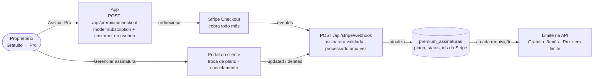
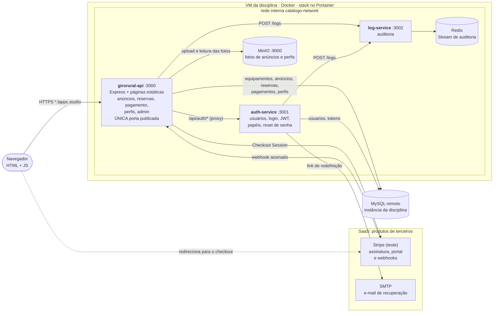
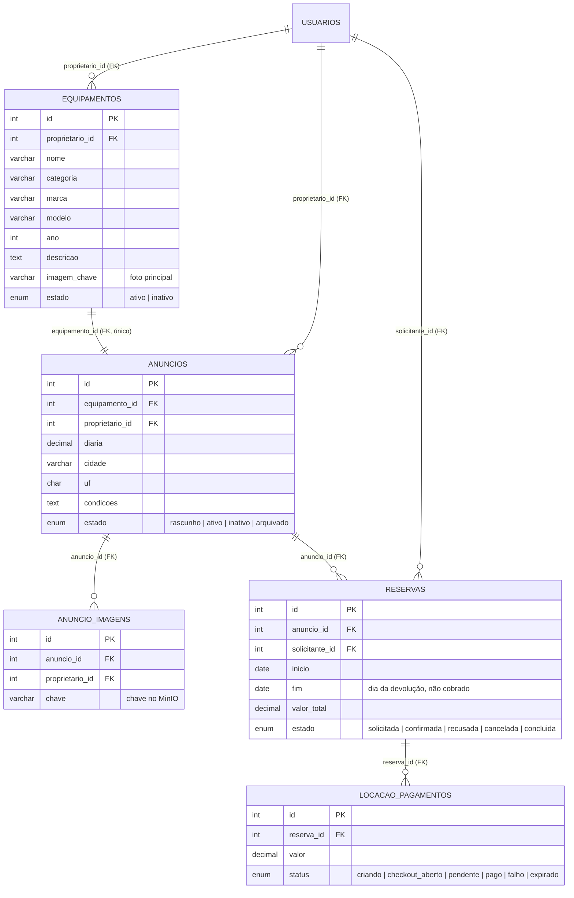

# GiroRural

**Aluguel de máquinas agrícolas entre produtores: quem tem trator, colheitadeira ou implemento parado anuncia por diária, e quem precisa encontra perto de casa, pede a reserva, paga depois da aprovação e combina a retirada direto com o dono.**

🌐 **No ar:** https://luana-abrantes-isw055.lapps.studio
📘 **API (Swagger):** https://luana-abrantes-isw055.lapps.studio/apidocs/

> Projeto da disciplina ISW055 (Introdução à Computação em Nuvem), Fatec Pompeia, proposto pelo professor [@siriani](https://github.com/siriani).
>
> **Atividade 10, "Seu negócio no ar":** o negócio do [plano de negócio](docs/plano-de-negocio.md) (atividade 9) rodando na mesma stack do Portainer das atividades anteriores (`girorural-luana-abrantes`), no mesmo subdomínio e com limite de 1 GB por container. A arquitetura de microsserviços das atividades 1 a 8 foi reaproveitada inteira; o domínio (máquinas, anúncios e reservas) é novo.

### Contas para testar

| Conta | Como acessar | O que mostra |
|---|---|---|
| **Fazenda Boa Vista** (proprietário) | `fazendaboavista@girorural.local` · senha `123456` | 33 máquinas anunciadas com fotos, pedidos recebidos para aprovar, Minha garagem |
| Locatário | Crie uma conta em `/cadastro.html`; todo cadastro nasce `LOCATARIO` | Buscar, reservar, pagar e acompanhar a locação |
| Novo anunciante | Na conta de locatário, **Habilitar modo anunciante** (`/anunciante.html`) | Vira `PROPRIETARIO` e passa a cadastrar máquinas |

A conta e os anúncios da Fazenda Boa Vista são criados automaticamente quando a API sobe (a senha vem de `CATALOGO_PROPRIETARIO_SENHA` na stack), por [`src/rural/catalogo.js`](src/rural/catalogo.js), a partir de [`database/catalogo-maquinas.json`](database/catalogo-maquinas.json).

**Roteiro de demonstração (5 minutos):** crie uma conta de locatário → abra um anúncio e peça a reserva com retirada para hoje → entre como Fazenda Boa Vista e aprove em **Minha garagem** → volte ao locatário, clique em **Pagar** e em **Simular pagamento aprovado** (o contato do dono é liberado) → como proprietário, clique em **Concluir locação**.

## SaaS completo: planos, limites e assinatura com Stripe

> **Atividade "SaaS completo" (entrega 13/11/2026)**, continuação do Plano Premium, proposta pelo professor [@siriani](https://github.com/siriani). O Plano Premium cobrava e marcava um campo; agora o anunciante tem plano gratuito, plano pago mensal, limite aplicado na API, troca de plano e cancelamento pelo portal do Stripe, e um painel com o MRR de teste. **Tudo em modo de teste do Stripe**: nenhuma cobrança é real, nenhuma chave está no repositório (só os nomes em [`.env.example`](.env.example)) e o cartão nunca passa pelo servidor.

### Modelo de receita (planos e limites)

| Plano | Preço no Stripe (teste) | Limite na API | Para quem |
|---|---|---|---|
| **Gratuito** | R$ 0,00/mês | **3 anúncios novos por mês** | Produtor testando com poucas máquinas; toda conta nasce aqui |
| **Pro** | **R$ 39,90/mês** (preço recorrente mensal em BRL) | **sem limite** | Produtor ou pequena locadora com várias máquinas |

Os valores ficam num lugar só, [`src/planos.js`](src/planos.js), usado pela API, pelas telas e pelo painel admin. Quem aluga não paga plano.

### O ciclo de vida da assinatura



O app só abre caminhos (checkout e portal). **Quem muda o plano no banco é sempre o webhook.** Voltar do checkout com `?plano=sucesso` não muda nada: a tela Minha garagem fica consultando o banco até o webhook confirmar.

### Os webhooks e o que cada um muda

Endpoint: `POST /api/stripe/webhook` ([`src/premium.js`](src/premium.js)). O corpo bruto é validado com `stripe.webhooks.constructEvent` e o segredo `STRIPE_WEBHOOK_SECRET`; sem assinatura válida ou com `livemode: true` a resposta é 400 e nada é gravado.

| Evento | O que o app faz |
|---|---|
| `checkout.session.completed` | Confere que a sessão é do usuário (`client_reference_id` e customer guardado), guarda a subscription no usuário e, com a fatura paga relida do Stripe, muda o plano para **Pro** |
| `customer.subscription.updated` | Atualiza status (`active`, `past_due`, `canceled`…), preço, cancelamento agendado e período pago; troca de plano no portal chega por aqui |
| `customer.subscription.deleted` | A assinatura terminou: status `canceled`, a conta volta para o **Gratuito** |
| `invoice.payment_failed` | Marca a assinatura como inadimplente e avisa o usuário na Minha garagem; o Pro **não** continua de graça: termina junto com o último período pago |
| `invoice.paid` (extra) | Confirma a renovação mensal e estende o período pago |

**Idempotência:** antes de processar, o id do evento entra em `stripe_eventos` (chave primária) dentro da mesma transação que atualiza o plano. Se o Stripe reenviar o evento, o `INSERT IGNORE` não insere nada e o processamento é pulado, sem efeito duplicado. Se o processamento falhar, a transação desfaz também o registro do evento e o Stripe pode reenviar. Eventos fora de ordem não sobrescrevem um estado mais novo (marca temporal `state_event_created`). Cada evento processado também vai para o log-service (`ASSINATURA_*`).

### Portal do cliente

O botão **Gerenciar assinatura** (Minha garagem → Plano) chama `POST /api/premium/portal`, que abre o **Billing Portal** do Stripe para o customer guardado no usuário da sessão. Lá o cliente troca de plano, atualiza o cartão e cancela sozinho. Para testar o cancelamento na hora, o portal está configurado com **cancelamento imediato**; com "no fim do período", o `customer.subscription.deleted` só chegaria no fim do mês.

### Limite por plano na API

`POST /api/anuncios` consulta o plano no banco **a cada requisição** ([`exigirLimiteAnuncios`](src/planos.js)). No Gratuito, o 4º anúncio do mês (rascunho também conta) é recusado com **402** e a mensagem:

> Limite do plano Gratuito atingido: 3 anúncios por mês (você já criou 3 neste mês). Assine o Pro por R$ 39,90/mês em Minha garagem > Plano para anunciar sem limite, ou aguarde o próximo mês.

Chamar a API direto dá o mesmo resultado que usar a tela. `GET /api/premium/uso` mostra o uso do mês e o limite do plano atual.

### Painel admin

Aba **Assinaturas e MRR** em `/admin.html` (`GET /api/admin/assinaturas`, só papel `ADMIN`): usuários em cada plano, assinaturas ativas, inadimplentes, **MRR de teste** (soma do valor mensal das assinaturas Pro ativas), assinaturas por status, lista de assinantes e os **últimos eventos do webhook**.

### Como testar (roteiro do professor)

1. Crie uma conta, habilite o modo anunciante: ela nasce no **Gratuito**.
2. Em **Anunciar máquina**, crie 3 anúncios; o 4º é recusado pela API com a mensagem acima.
3. Em **Minha garagem → Plano**, clique em **Assinar Pro** e pague com `4242 4242 4242 4242`, qualquer data futura e qualquer CVC.
4. Volte ao app: a tela espera o webhook e mostra **Plano Pro · anúncios sem limite**.
5. Clique em **Gerenciar assinatura** e cancele no portal. Quando chega o `customer.subscription.deleted`, a conta volta para o Gratuito.
6. Entre como admin e abra **Assinaturas e MRR**.

Cartões que recusam a renovação (por exemplo `4000 0000 0000 0341`) servem para ver o `invoice.payment_failed`.

### Configuração (somente variáveis da stack no Portainer)

| Variável | O que é |
|---|---|
| `STRIPE_SECRET_KEY` | Chave secreta **de teste** (`sk_test_…`); chave `sk_live_` é recusada pelo código |
| `STRIPE_PRICE_ID` | Preço recorrente mensal do Pro (R$ 39,90, BRL) |
| `STRIPE_PRICE_FREE_ID` | Opcional: preço Free (R$ 0/mês). Com ele no portal, o cliente troca Pro → Gratuito sozinho (o webhook grava o plano Gratuito) |
| `STRIPE_WEBHOOK_SECRET` | Segredo do endpoint `https://<subdomínio>/api/stripe/webhook` |
| `STRIPE_PORTAL_CONFIGURATION_ID` | Opcional: configuração do portal (`bpc_…`); vazio usa a padrão do modo de teste |
| `APP_BASE_URL` | Origem pública, usada no retorno do checkout e do portal |

Banco: [`database/migracao-saas-completo.sql`](database/migracao-saas-completo.sql) cria `premium_assinaturas` e `stripe_eventos` se ainda não existirem (aditiva e reexecutável).

---

## Sumário
0. [SaaS completo: planos, limites e assinatura com Stripe](#saas-completo-planos-limites-e-assinatura-com-stripe)
1. [O que está no ar](#1-o-que-está-no-ar)
2. [Requisitos da atividade 10](#2-requisitos-da-atividade-10)
3. [Arquitetura](#3-arquitetura)
4. [Domínio: tabelas, migrations e seed](#4-domínio-tabelas-migrations-e-seed)
5. [Papéis e permissões (403)](#5-papéis-e-permissões-403)
6. [Isolamento por usuário (404)](#6-isolamento-por-usuário-404)
7. [Eventos de auditoria](#7-eventos-de-auditoria)
8. [Upload no object storage](#8-upload-no-object-storage)
9. [Como rodar](#9-como-rodar)
10. [Deploy em produção](#10-deploy-em-produção)
11. [Documentação](#11-documentação)

---

## 1. O que está no ar

| Tela | Rota | O que faz |
|---|---|---|
| Landing pública | `/` | Proposta de valor, categorias, máquinas em destaque, como funciona e o botão **Criar conta** |
| Catálogo | `/anuncios.html` | Busca por nome, marca ou modelo; filtros por categoria, cidade e faixa de diária; ordenação por preço |
| Detalhe do anúncio | `/anuncio.html?id=` | Galeria de fotos, ficha técnica, condições, calculadora de diárias e pedido de reserva |
| Perfil público do proprietário | `/proprietario.html?id=` | Nome, cidade, apresentação e as máquinas anunciadas (sem e-mail nem telefone) |
| Entrar · Criar conta · Esqueci a senha | `/login.html`, `/cadastro.html`, `/esqueci-senha.html` | Conta própria com JWT em cookie; recuperação de senha por e-mail com link de uso único |
| Meu perfil | `/perfil.html` | Dados pessoais, localização, apresentação pública, foto (MinIO) e troca de senha |
| Modo anunciante | `/anunciante.html` | O locatário aceita os termos, completa telefone, cidade e UF e vira proprietário |
| Anunciar máquina | `/anunciar.html` | Assistente em 3 passos: máquina, preço e local, fotos (até 8) |
| Minha garagem | `/painel.html` | Anúncios do proprietário (editar, pausar, fotos), pedidos recebidos, plano e uso do mês, **Assinar Pro** e **Gerenciar assinatura** |
| Minhas reservas · Reserva | `/minhas-reservas.html`, `/reserva.html?id=` | Linha do tempo do pedido, ações por papel e contato liberado após a aprovação |
| Pagamento | `/pagamento.html?reserva_id=` | Stripe Checkout (modo de teste) ou pagamento simulado aprovado/recusado |
| Administração | `/admin.html` | Indicadores, **assinaturas e MRR de teste**, moderação de anúncios, reservas, usuários e papéis, eventos de auditoria |
| Créditos das fotos | `/creditos.html` | Autor e licença de cada foto do catálogo (Wikimedia Commons) |

Layout responsivo, que funciona no celular.

**Pagamento da locação:** o locatário só paga depois que o dono aprova, e a aprovação vale 24 horas. Com `STRIPE_SECRET_KEY` de teste configurada, o botão abre o Stripe Checkout (`mode=payment`), e a reserva só fica paga quando chega o webhook assinado. Sem Stripe, ou com `PAGAMENTO_SIMULADO=true` (padrão), a tela oferece **Simular pagamento aprovado/recusado**, que grava o mesmo registro em `locacao_pagamentos`. Nenhuma cobrança real acontece.

**Planos do anunciante:** Gratuito (3 anúncios novos por mês) e Pro (R$ 39,90/mês, sem limite), por assinatura Stripe (`mode=subscription`) em modo de teste, com portal do cliente. Detalhes na [seção SaaS](#saas-completo-planos-limites-e-assinatura-com-stripe).

**Fora do escopo desta versão:** repasse automático ao proprietário (Stripe Connect), reembolso após pagamento e avaliações entre usuários.

## 2. Requisitos da atividade 10

| # | Requisito | Onde está |
|---|---|---|
| R1 | Stack aponta para o repositório novo | Stack `girorural-luana-abrantes` no Portainer, apontando para este repositório e para [`docker-compose.portainer.yml`](docker-compose.portainer.yml) |
| R2 | ≥ 3 tabelas de domínio com FK, por migration + seed versionados | `equipamentos`, `anuncios`, `reservas` (mais `anuncio_imagens` e `locacao_pagamentos`) em [`database/migracao-girorural-issue1.sql`](database/migracao-girorural-issue1.sql) e nas migrations seguintes; seed em [`database/catalogo-maquinas.json`](database/catalogo-maquinas.json), aplicado por [`src/rural/catalogo.js`](src/rural/catalogo.js) |
| R3 | CRUD do recurso principal | Equipamentos e anúncios: criar, listar, detalhar, editar e desativar, em [`src/rural/rotas.js`](src/rural/rotas.js) |
| R4 | Telas de listar, criar, detalhe e editar | Catálogo, Anunciar máquina, Detalhe do anúncio e Minha garagem, em [`public/`](public) |
| R5 | ≥ 3 papéis, ação proibida dá 403 mesmo pela API | `LOCATARIO`, `PROPRIETARIO` e `ADMIN`, mais o plano Pro. [Seção 5](#5-papéis-e-permissões-403); `exigir(...)` em [`src/rural/rotas.js`](src/rural/rotas.js) |
| R6 | Isolamento por usuário: recurso de outro dá 403/404 | [Seção 6](#6-isolamento-por-usuário-404); as consultas filtram pelo dono na própria query |
| R7 | Eventos de negócio no log-service | [Seção 7](#7-eventos-de-auditoria) |
| R8 | Upload no MinIO ligado a um registro | Fotos do anúncio (`anuncio_imagens`) e foto de perfil. [Seção 8](#8-upload-no-object-storage) |
| R9 | Landing pública com proposta de valor e cadastro | [`/`](https://luana-abrantes-isw055.lapps.studio), em [`public/index.html`](public/index.html) |
| R10 | Nada do domínio anterior no código ou nas telas | Telas, rotas e serviços do catálogo de filmes removidos; a variável da API externa de filmes saiu do compose. Só o nome da rede Docker `catalogo-network` foi mantido, para não recriar a rede da stack |

Os testes automatizados (`npm test`, 103 casos) cobrem R3, R5, R6, R7 e R8: `test/rural-api.test.js`, `test/rural.test.js`, `test/locacao.test.js`, `test/admin.test.js`, `test/minio.test.js` e `test/perfil-api.test.js`. O CI também valida o contrato OpenAPI e constrói as quatro imagens antes de publicar.

## 3. Arquitetura



| Serviço | Pasta · imagem (GHCR) | Responsabilidade |
|---|---|---|
| **girorural-api** | `src/` + `public/` · `girorural-api` | Porta de entrada pública: serve as telas, a API do negócio, perfis, pagamentos, admin e o Swagger; repassa `/api/auth/*` |
| **auth-service** | `auth-service/` · `girorural-auth-service` | Cadastro, login, JWT, papéis, modo anunciante e redefinição de senha |
| **log-service** | `log-service/` · `girorural-log-service` | Grava e devolve os eventos de auditoria (Redis Streams) |
| **MinIO** | `minio/` · `girorural-minio` | Object storage S3 com bucket privado |
| **Redis** | `redis:7-alpine` | Guarda a trilha de auditoria |
| **MySQL** | fora da stack | Banco da disciplina, usado pela api e pelo auth-service |

**Camadas de nuvem:** a VM da disciplina é **IaaS**; os containers, o banco da disciplina e o GitHub Actions são **PaaS** (eu entrego a imagem e o workflow, e a plataforma executa); Stripe, GitHub/GHCR e o proxy HTTPS do domínio são **SaaS**.

## 4. Domínio: tabelas, migrations e seed



- **DDL versionado** em [`database/`](database), aplicado nesta ordem: `migracao-girorural-issue1.sql` (cria as três tabelas), `migracao-girorural-atividade10.sql` (colunas, índices e FK do proprietário), `migracao-perfil-usuarios.sql`, `migracao-anuncios-informacoes.sql`, `migracao-anuncios-galeria.sql`, `migracao-locacao-stripe.sql` e `migracao-girorural-produto.sql`. Todas são aditivas e podem rodar de novo (`IF NOT EXISTS`).
- **Regras no banco:** as FKs são `RESTRICT`, então não dá para apagar um usuário ou anúncio que tenha reservas. "Excluir" na API é desativação lógica (`estado='inativo'`). `CHECK` garante diária positiva, UF válida e `fim >= inicio`.
- **Regras na API:** o valor total é calculado no servidor (diária × diárias); duas reservas aprovadas não podem se sobrepor no mesmo anúncio; ninguém reserva o próprio anúncio.
- **Seed:** ao subir, a API garante a conta **Fazenda Boa Vista** e os 33 anúncios de [`database/catalogo-maquinas.json`](database/catalogo-maquinas.json) (tratores, colheitadeiras, plantadeiras, pulverizadores, preparo do solo, transporte e distribuidores). Pode rodar de novo: só cria o que ainda não existe. Desliga com `CATALOGO_INICIAL=false`.

## 5. Papéis e permissões (403)

O papel vem **só** do JWT emitido pelo auth-service, e quem barra é a API (`exigir(...)` em [`src/rural/rotas.js`](src/rural/rotas.js) e `exigirAdmin` em [`src/rural/admin.js`](src/rural/admin.js)); as telas apenas escondem botões. O admin modera, mas não age no lugar de proprietários e locatários. O cadastro público sempre cria `LOCATARIO`: mandar `role=ADMIN` no corpo não concede nada.

| Ação | Sem sessão | `LOCATARIO` | `PROPRIETARIO` | `ADMIN` |
|---|---|---|---|---|
| Ver catálogo e anúncios ativos | ✅ | ✅ | ✅ | ✅ |
| Pedir reserva, pagar, cancelar antes da aprovação | **401** | ✅ | ✅ (de outros donos) | **403** |
| Cadastrar/editar equipamento e anúncio, enviar fotos | **401** | **403** | ✅ (Gratuito: 3 anúncios novos/mês, 402 acima disso; Pro: sem limite) | **403** |
| Aprovar, recusar e concluir reserva | **401** | **403** | ✅ (só dos próprios anúncios) | **403** |
| `/api/admin/*` (usuários, papéis, moderação, reservas, resumo) e `/api/logs` | **401** | **403** | **403** | ✅ |

- O locatário vira proprietário sozinho, pelo **modo anunciante** (`POST /api/auth/anunciante`), depois de aceitar os termos e completar telefone, cidade e UF.
- Anúncio suspenso pelo admin sai do catálogo, e o dono não consegue reativá-lo até a liberação.
- O admin não pode remover o próprio papel nem o último admin.
- Toda ação barrada gera o evento `ACAO_NEGADA` no log-service.

## 6. Isolamento por usuário (404)

Toda consulta privada filtra pelo dono **na query** (`proprietario_id` ou `solicitante_id` vindo do JWT), nunca pela tela. Recurso de outra pessoa responde **`404`**, como se não existisse (um `403` revelaria que o ID existe):

- `PUT/DELETE /api/equipamentos/:id` e `/api/anuncios/:id` de outro proprietário → `404`;
- fotos de anúncio de outro proprietário (enviar, remover, definir principal) → `404`;
- `GET /api/reservas/:id` só responde para as duas partes da reserva; para qualquer outra conta → `404`;
- `PATCH /api/reservas/:id` (aprovar/recusar) e `/concluir` só para o dono do anúncio → `404`;
- pagamento de reserva de outra pessoa → `404`;
- o perfil público (`/api/proprietarios/:id`) nunca devolve e-mail nem telefone; o contato só aparece em `/reserva.html` depois da aprovação.

Testes: casos de outro usuário em `test/rural-api.test.js`, `test/rural.test.js` e `test/locacao.test.js`.

## 7. Eventos de auditoria

A api e o auth-service mandam `POST /logs` para o log-service. Se ele estiver fora, a ação do usuário continua. Cada evento tem `usuario_id`, `acao`, alvo, data (UTC) e IP. Só o admin consulta (`GET /api/logs` ou a aba **Auditoria** em `/admin.html`), que também destaca contas com muitas ações negadas.

| Evento | Quando |
|---|---|
| `EQUIPAMENTO_CADASTRADO`, `EQUIPAMENTO_ATUALIZADO`, `EQUIPAMENTO_DESATIVADO` | CRUD de equipamento |
| `ANUNCIO_CRIADO`, `ANUNCIO_ATUALIZADO`, `ANUNCIO_DESATIVADO` | CRUD de anúncio |
| `FOTOS_ANUNCIO_ADICIONADAS`, `FOTO_ANUNCIO_REMOVIDA`, `FOTO_PRINCIPAL_ATUALIZADA`, `FOTO_EQUIPAMENTO_ENVIADA` | Fotos no MinIO |
| `RESERVA_SOLICITADA`, `RESERVA_APROVADA`, `RESERVA_RECUSADA`, `RESERVA_CANCELADA`, `RESERVA_CONCLUIDA` | Ciclo da reserva |
| `LOCACAO_CHECKOUT_INICIADO`, `LOCACAO_PAGA`, `LOCACAO_PAGAMENTO_FALHO`, `LOCACAO_APROVACAO_EXPIRADA` | Pagamento da locação |
| `ANUNCIO_SUSPENSO`, `ANUNCIO_LIBERADO`, `ROLE_ALTERADA` | Moderação e papéis (admin) |
| `ASSINATURA_CHECKOUT_CONCLUIDO`, `ASSINATURA_ATUALIZADA`, `ASSINATURA_ENCERRADA`, `ASSINATURA_FATURA_PAGA`, `ASSINATURA_PAGAMENTO_FALHOU` | Webhooks da assinatura (uma vez por evento) |
| `ANUNCIANTE_HABILITADO` | Locatário virou proprietário |
| `LOGIN`, `LOGOUT`, `PERFIL_ATUALIZADO`, `FOTO_PERFIL_ATUALIZADA`, `FOTO_PERFIL_REMOVIDA` | Conta e perfil |
| `ACAO_NEGADA` | Toda ação barrada com 403 |

## 8. Upload no object storage

As **fotos do anúncio** ficam ligadas ao anúncio:

1. `POST /api/anuncios/:id/fotos` (multipart, campo `fotos`): até **8 fotos** por envio e **12 por anúncio**, JPEG, PNG ou WebP de até **5 MB** cada. Só o dono do anúncio envia.
2. A imagem é decodificada e regravada no servidor (o que descarta EXIF e recusa arquivo que não seja imagem de verdade) e vai para o bucket privado na chave `anuncios/{usuario_id}/{uuid}.{ext}`, gerada pelo servidor. O banco guarda só a chave (`anuncio_imagens`).
3. O navegador nunca fala com o MinIO: `GET /api/anuncios/:id/fotos/:fotoId` passa pela API, que confere se o anúncio está ativo ou é do próprio dono.
4. A primeira foto vira a principal (`equipamentos.imagem_chave`), e o dono pode trocar a principal ou remover fotos.

A **foto de perfil** segue o mesmo caminho (`POST /api/perfil/me/foto`, chave `perfis/{usuario_id}/{uuid}`).

As fotos do catálogo inicial têm licença livre (Wikimedia Commons) e ficam em [`public/imagens/catalogo/maquinas/`](public/imagens/catalogo/maquinas), com autor e licença em `manifest.json` e na página `/creditos.html`.

## 9. Como rodar

### Tudo com Docker Compose (recomendado)

```bash
cp .env.example .env    # preencha JWT_SECRET, MINIO_*, MAIL_* e, se quiser, STRIPE_* de teste
docker compose -f docker-compose.yml -f docker-compose.local-dev.yml -p girorural-local-dev up -d --build
```

- Site e API em http://localhost:3000 (Swagger em `/apidocs/`; auth-service em `/apidocs/auth/`).
- O Compose local inclui um MariaDB isolado, que recebe as migrations de `database/` no primeiro boot. O catálogo da Fazenda Boa Vista é criado quando a API sobe; defina `CATALOGO_PROPRIETARIO_SENHA` no `.env` para entrar nessa conta.
- Só a api publica porta; auth-service, log-service, Redis e MinIO ficam na rede interna.

### Testes

```bash
npm ci && npm ci --prefix auth-service && npm ci --prefix log-service
npm test                  # api, auth e log (node:test, banco e serviços simulados)
npm run docs:validate     # valida o contrato OpenAPI
```

## 10. Deploy em produção

`git push` na `main` → o GitHub Actions ([`.github/workflows/cicd.yml`](.github/workflows/cicd.yml)) roda os testes, valida o OpenAPI, constrói as 4 imagens e as publica no GHCR com a tag `sha-<commit completo>`. No Portainer, na stack `girorural-luana-abrantes`, troca-se `IMAGE_TAG` para a nova tag e clica-se em **Update the stack**. Cada serviço tem `mem_limit: 1g`.

**Variáveis da stack no Portainer** (nunca no repositório): banco (`DB_HOST`, `DB_PORT`, `DB_USER`, `DB_PASSWORD`, `DB_NAME`), sessão (`JWT_SECRET`), MinIO (`MINIO_ACCESS_KEY`, `MINIO_SECRET_KEY`, `MINIO_BUCKET`), e-mail (`MAIL_*`), Stripe de teste (`STRIPE_SECRET_KEY`, `STRIPE_PRICE_ID`, `STRIPE_WEBHOOK_SECRET`, `STRIPE_PORTAL_CONFIGURATION_ID`, `STRIPE_LOCACAO_WEBHOOK_SECRET` e `APP_BASE_URL`) e catálogo (`CATALOGO_PROPRIETARIO_EMAIL`, `CATALOGO_PROPRIETARIO_SENHA`, `CATALOGO_INICIAL`, `PAGAMENTO_SIMULADO`).

**Migrations em produção** são manuais, uma vez, com backup antes, pelo cliente MySQL apontando para o banco da disciplina, na ordem da [seção 4](#4-domínio-tabelas-migrations-e-seed), mais [`database/migracao-saas-completo.sql`](database/migracao-saas-completo.sql) para as assinaturas. O seed não precisa de passo manual: a API o aplica ao subir.

## 11. Documentação

- [Plano de negócio](docs/plano-de-negocio.md): dor, persona, concorrentes, proposta de valor, receita com Stripe, métricas, Lean Canvas, mapa de reaproveitamento e LGPD (atividade 9).
- [Documentação do sistema](DOCUMENTACAO.md): especificação, regras de negócio e modelo de dados.
- [Arquitetura](docs/arquitetura-girorural.md) e [modelo de dados e isolamento](docs/modelo-dados-isolamento.md).
- [Relatório P1](docs/P1_ISW055_Luana_Abrantes.pdf): atividades 1 a 8.
- API: `/apidocs/` (Swagger) na api; contratos em [`docs/openapi/`](docs/openapi).
