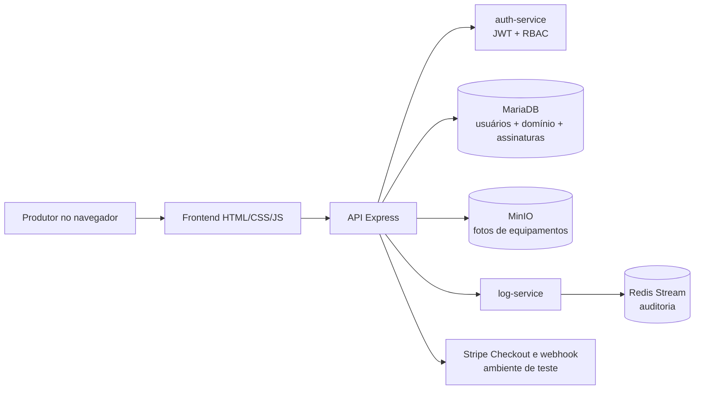

# GiroRural

Plataforma SaaS para aproximar produtores rurais que oferecem máquinas e implementos daqueles que precisam alugá-los. O GiroRural organiza anúncios e solicitações de reserva; o pagamento do aluguel é combinado diretamente entre proprietário e locatário.

Professor da atividade ISW055: [@siriani](https://github.com/siriani). Esta branch prepara a atividade “Seu negócio no ar”; não representa uma publicação em produção.

## Funcionalidades

- Landing page pública, busca pública por cidade e categoria e detalhes públicos sem dados de conta.
- Cadastro e gerenciamento de equipamentos e anúncios por proprietários, com desativação lógica e upload de foto no MinIO.
- Solicitações de reserva por período, consulta das próprias solicitações e aprovação/recusa pelo proprietário. Períodos confirmados sobrepostos são recusados com bloqueio transacional do anúncio.
- Administração de papéis e consulta de auditoria no painel administrativo existente, adaptado ao GiroRural.
- Limites aplicados na API: Gratuito até 2 anúncios ativos; Pro até 20. Assinatura Stripe apenas em modo de teste e validada pelo preço configurado.
- A API não aceita `usuario_id` do cliente para decidir autoria. Recursos privados alheios retornam 404; papel autenticado sem permissão recebe 403; ausência de sessão recebe 401.

## Estado real da entrega

O código da atividade está em revisão local na branch `atividade-10-girorural-no-ar`. O repositório remoto contém uma fundação anterior para migração e isolamento, que foi reutilizada. Nenhuma alteração foi enviada, integrada à `main`, publicada no Portainer ou usada para criar a issue final.

O checkout local original estava vazio. A branch foi montada sobre `feature/issue-1-modelo-dados-isolamento`, que traz a fundação não integrada da Issue #1. O histórico Git foi mantido.

Validação local em 29/10/2026: `npm test` passou com **88 testes aprovados e 0 falhas**; `npm run docs:generate` gerou 33 operações GiroRural e 9 de autenticação; `npm run docs:validate` validou ambos os documentos OpenAPI. `node scripts/validar-rural-mariadb.js` foi tentado, mas o Docker Desktop negou acesso ao named pipe `docker_engine`; portanto, não houve execução real em MariaDB, Redis ou MinIO. Os testes automatizados usam duplos e não comprovam esses serviços reais. Relatórios e prints de etapas antigas estão em [documentação histórica](docs/historico/README.md).

## Arquitetura



O banco MariaDB é externo ao `docker-compose.yml` existente. Redis, MinIO, API, auth-service e log-service permanecem serviços de apoio da stack. As fotos de anúncios ficam sob chaves privadas `anuncios/<usuario>/<uuid>.<formato>`; a API serve fotos somente quando o anúncio está ativo ou o proprietário autenticado é o dono.

## Papéis e permissões

| Papel de negócio | Permissões |
| --- | --- |
| `ADMIN` | Gerenciar papéis por `/api/admin/usuarios`, consultar auditoria em `/api/logs`; não ignora propriedade dos registros. |
| `PROPRIETARIO` | Criar equipamentos e anúncios; editar, desativar e enviar foto somente aos próprios anúncios; consultar pedidos recebidos e aprovar ou recusar solicitações. |
| `LOCATARIO` | Ler anúncios ativos; pedir, consultar e cancelar as próprias reservas. |

Novas contas recebem `LOCATARIO`, independente do campo `role` enviado no cadastro. Um administrador pode atribuir `PROPRIETARIO`. A conta legada `usuario` é tratada como `LOCATARIO`; `admin` é preservado para compatibilidade e equivale a `ADMIN` no domínio. O sistema não altera automaticamente os papéis das contas existentes.

## Dados e migrações

| Tabela | Relações e principais campos |
| --- | --- |
| `equipamentos` | Proprietário (`usuarios.id`), nome, categoria, marca, modelo, ano, descrição, chave de imagem e estado. |
| `anuncios` | Equipamento, proprietário (`usuarios.id`), diária `DECIMAL(10,2)`, cidade, UF, condições e estado. Um anúncio por equipamento. |
| `reservas` | Anúncio, solicitante (`usuarios.id`), período, estado e datas. Índices para consultas por solicitante e período; chaves estrangeiras `RESTRICT`. |

As migrações aditivas não apagam nem recriam tabelas de autenticação, assinaturas ou dados existentes:

1. `database/migracao-girorural-issue1.sql` cria o domínio base.
2. `database/migracao-girorural-atividade10.sql` acrescenta marca/modelo/ano/imagem, proprietário no anúncio, índices e FK.
3. `scripts/migrar-rural.js` valida `usuarios.id` e aplica as duas migrações somente em banco local `girorural_dev_*` ou `girorural_test_*` usando variáveis `GIRO_DEV_DB_*`. O script não lê `.env` nem `DB_*`.
4. `database/seed-girorural.sql` é opcional e idempotente. Em uma sessão SQL local, defina `@giro_owner_id` para uma conta `PROPRIETARIO` antes de executá-lo; seed não atualiza dados existentes.

As migrações de autenticação e Stripe herdadas (`migracao-atividade3.sql`, `migracao-atividade6.sql`, `migracao-atividade7.sql` e `migracao-atividade7-periodo.sql`) ainda são pré-requisitos do ambiente completo. A migração de atividade 3 pressupõe uma tabela `usuarios` já existente, cujo DDL original não está neste repositório. Para reverter o domínio local, pare os escritores, confirme manutenção exclusiva e use `node scripts/migrar-rural.js --reverter --manutencao-exclusiva`; a reversão só remove tabelas do domínio quando estão vazias.

## Endpoints principais

| Método e rota | Acesso |
| --- | --- |
| `GET /api/anuncios`, `GET /api/anuncios/:id` | Público; somente anúncios e equipamentos ativos. Filtros `cidade`, `categoria`, `pagina`, `limite` (máximo 50). |
| `POST /api/equipamentos`, `GET /api/equipamentos/meus` | `PROPRIETARIO`. |
| `POST /api/anuncios`, `GET /api/anuncios/meus`, `PUT /api/anuncios/:id`, `DELETE /api/anuncios/:id` | `PROPRIETARIO`; `DELETE` desativa. |
| `POST /api/anuncios/:id/foto`, `GET /api/anuncios/:id/foto` | Proprietário autenticado para upload; leitura pública de anúncio ativo ou privada para o dono. JPEG, PNG ou WebP de até 5 MB. |
| `POST /api/reservas`, `GET /api/reservas/minhas`, `GET /api/reservas/:id`, `POST /api/reservas/:id/cancelar` | `LOCATARIO`; consulta individual só para solicitante ou proprietário do anúncio. |
| `GET /api/reservas/recebidas`, `PATCH /api/reservas/:id` | `PROPRIETARIO`; o corpo de decisão aceita `confirmada` ou `recusada`. |
| `GET /api/admin/usuarios`, `PATCH /api/admin/usuarios/:id/role`, `GET /api/logs` | `ADMIN` legado/administrador. |
| `GET /health`, `GET /live`, `GET /metrics`, `GET /apidocs/` | Saúde, liveness, métricas e OpenAPI. Auth-service tem documentação interna em `/apidocs/auth/`. |

## Execução local

Requisitos: Node.js 20+, MariaDB local com a tabela `usuarios` compatível com `INT` assinado como chave primária e Docker com Engine Linux para o laboratório integrado. Redis e MinIO são levantados pelo Compose local.

```powershell
npm install
npm install --prefix auth-service
npm install --prefix log-service
Copy-Item .env.example .env
Copy-Item auth-service/.env.example auth-service/.env
```

Preencha os arquivos locais com credenciais de desenvolvimento. Não use credenciais de produção. Configure `DB_HOST`, `DB_PORT`, `DB_USER`, `DB_PASSWORD`, `DB_NAME`, `JWT_SECRET`, `MINIO_ACCESS_KEY` e `MINIO_SECRET_KEY`. Inicie a infraestrutura e a aplicação:

```powershell
docker compose up --build
```

O Compose não cria MariaDB; configure uma instância local compatível e aplique primeiro as migrações legadas necessárias, depois `node scripts/migrar-rural.js --aplicar`. A CLI rural só aceita host loopback e nomes de banco `girorural_dev_*` ou `girorural_test_*`.

Para habilitar Pro localmente, configure chaves Stripe `sk_test_`, `STRIPE_PRICE_ID` apontando para um preço recorrente ativo de **R$ 39,90 BRL por mês**, `STRIPE_WEBHOOK_SECRET` de teste e `APP_BASE_URL` local. O preço antigo de R$ 9,90 não é usado como preço GiroRural. Nenhuma cobrança de aluguel passa pelo Stripe.

## Testes e evidências

Verificações disponíveis:

```powershell
npm test
npm run docs:validate
node scripts/validar-rural-mariadb.js
```

`npm test` executa a suíte automatizada da aplicação. `validar-rural-mariadb.js` cria um banco MariaDB isolado em containers descartáveis; requer Docker Desktop autorizado a executar containers Linux. Testes com duplos de API não substituem uma integração real com MariaDB, Redis ou MinIO. A seção de [evidências da atividade](docs/evidencias/atividade-10/README.md) lista as capturas ainda necessárias; nenhum print de produção é fabricado.

## Portainer após aprovação

Use a **stack já existente** e o arquivo `docker-compose.portainer.yml`; não crie uma stack nova. O template mantém o mapeamento `8216:3000`, o mesmo subdomínio `https://luana-abrantes-isw055.lapps.studio`, a rede `catalogo-network`, os volumes nomeados `minio-data` e `audit-redis-data`, e MariaDB externo. A service key da API passa a `girorural-api`; a aplicação anterior será substituída na mesma stack após aprovação. O Compose não declara limite de memória; o limite atual de 1 GB por container precisa ser confirmado na configuração real do Portainer antes da atualização e preservado.

Procedimento planejado, não executado nesta branch: (1) apontar a stack existente para `https://github.com/Luanaabrantes/girorural.git` e o branch/commit aprovado; (2) selecionar `docker-compose.portainer.yml`; (3) configurar a origem das quatro imagens `ghcr.io/luanaabrantes/girorural-{api,auth-service,log-service,minio}` e `IMAGE_TAG=sha-<commit>` verificado; (4) preservar secrets, rede, subdomínio, porta, limites e volumes atuais; (5) atualizar a stack existente e confirmar health checks. Se os pacotes GHCR forem privados, manter/configurar as credenciais de registry já autorizadas. Remover `TMDB_TOKEN` do Portainer somente depois da revisão e em uma alteração aprovada separada. Nenhuma configuração do Portainer foi alterada.

## Limitações conhecidas

- O endereço público e estado de publicação continuam pendentes de aprovação e deploy.
- Relatórios Pro de locações não foram implementados.
- A concorrência de conflito deve ser validada no MariaDB real pelo laboratório; Redis não é usado como mecanismo de integridade.
- A fundação de migração tem pré-requisito de usuários existente. O seed cria um equipamento demonstrativo apenas para proprietário escolhido localmente.
- O conteúdo do catálogo antigo permanece no histórico Git e em documentos de rastreabilidade, mas seus endpoints e telas não fazem parte da aplicação atual.

## URL pública

Pendente de validação após deploy autorizado: `<URL a preencher após publicação>`.
