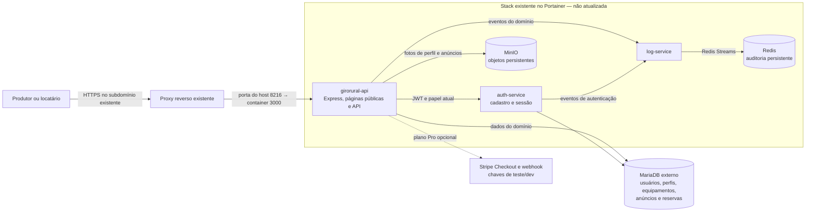

# Arquitetura do GiroRural

Diagrama do estado funcional desta branch. A publicação no servidor da disciplina ainda não foi realizada; a parte do Portainer representa a configuração pretendida pelo template versionado, não uma leitura da stack viva.

## Observações operacionais

- O navegador acessa somente o host público/API. Auth-service, log-service, MinIO e Redis são serviços internos à rede da stack.
- A API lê e grava metadados no MariaDB. O binário das imagens fica no MinIO; o Redis Stream armazena eventos de auditoria.
- O arquivo [`../docker-compose.portainer.yml`](../docker-compose.portainer.yml) aponta para o MariaDB externo e mantém a chave de rede `catalogo-network` do projeto anterior para compatibilidade. A associação à rede e o proxy reverso precisam ser conferidos na stack viva antes do redeploy.
- `docker-compose.local-dev.yml` complementa a stack local com MariaDB isolado e bootstrap. Os dados locais e volumes não são parte do histórico Git.
- Limites de memória, repositório/branch configurados no Portainer, credenciais GHCR e o estado real do subdomínio não estão representados pelo Compose e não foram inspecionados.
