# Evidências da atividade 10

Prints tirados no site em produção (https://luana-abrantes-isw055.lapps.studio) em 06/11/2026, na versão `cb2ecfd`.

Landing pública com a proposta de valor e o botão de cadastro:

Catálogo com as máquinas anunciadas e os filtros:

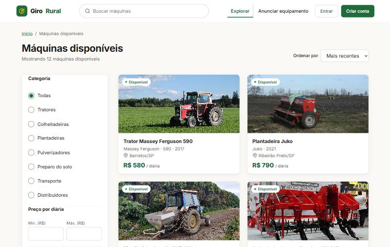

Minha garagem da Fazenda Boa Vista, com as solicitações recebidas:

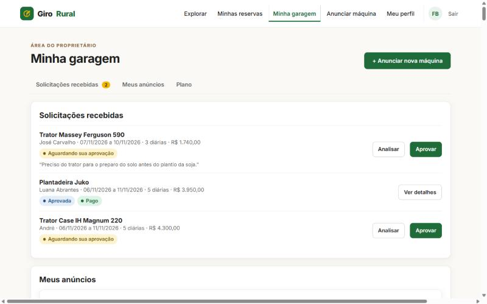

Cadastro de máquina (Anunciar máquina, passo 1):

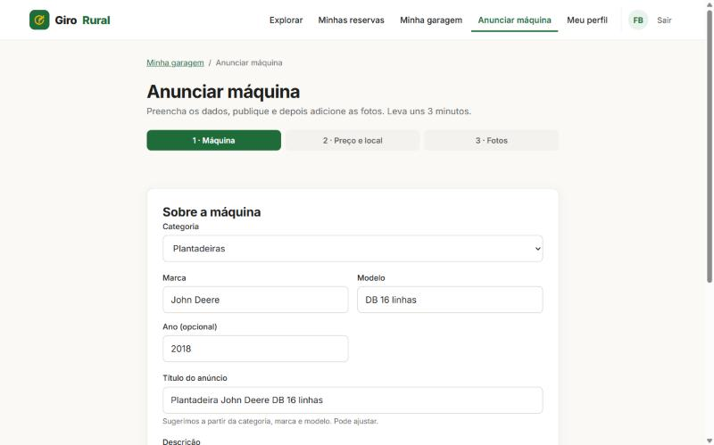

403: o José (locatário) chama `POST /api/anuncios` direto pela API. A API responde 403 "Papel sem permissão para esta operação":

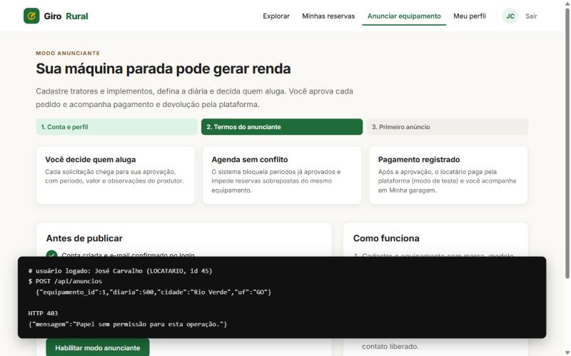

404: o José abre a reserva #1, que é de outra pessoa. A tela e a API respondem 404 "Reserva não encontrada":

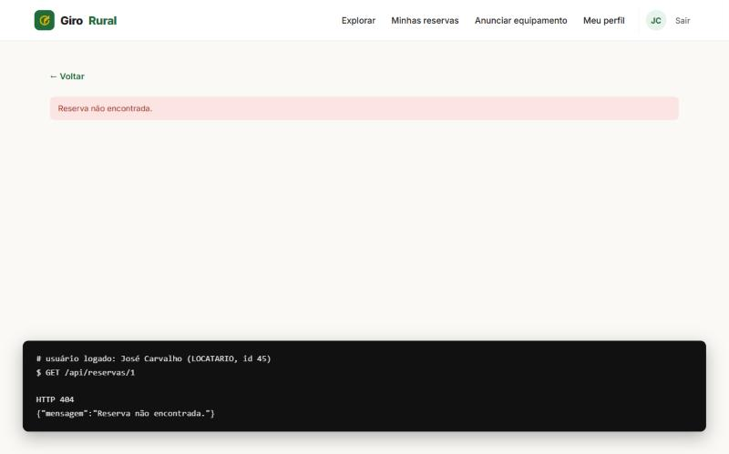

Upload ligado ao registro: foto enviada para o anúncio #34 (vira a foto principal):

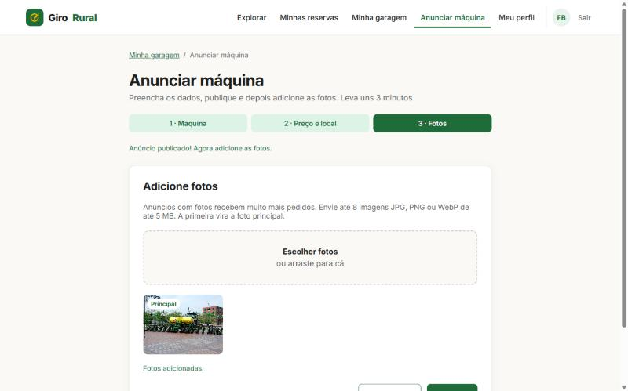

Arquivo no object storage: a foto do anúncio #34 é lida pela API no bucket privado do MinIO (`GET /api/anuncios/34/fotos/1`, 200, image/jpeg); o navegador nunca acessa o MinIO direto:

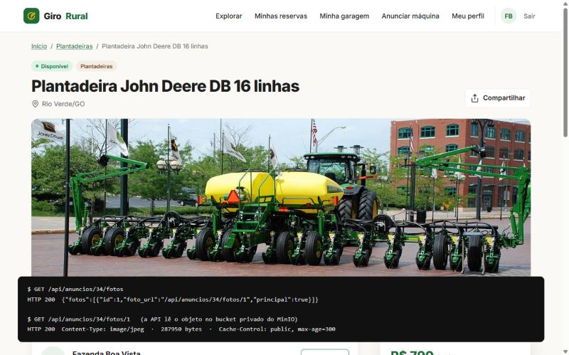

Fluxo de locação: o José pede a reserva, a Fazenda aprova e o contato das duas partes é liberado:

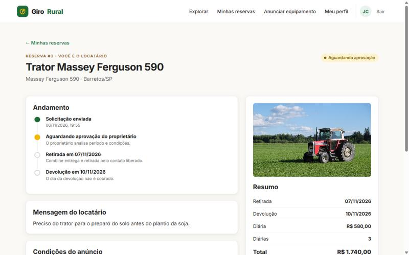
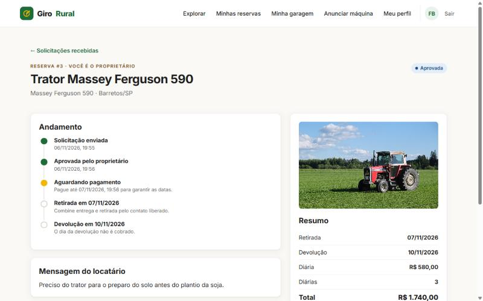
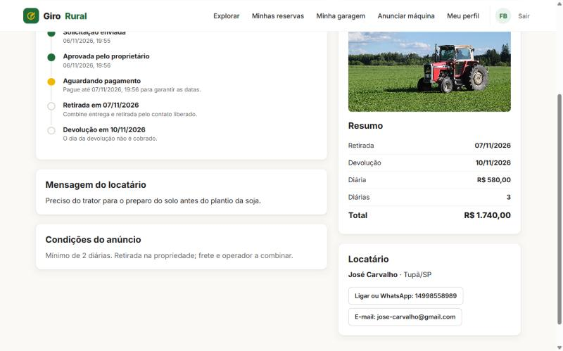

Eventos de negócio no log-service (painel de admin, aba Auditoria): reserva solicitada, aprovada, equipamento e anúncio criados, fotos enviadas e o `ACAO_NEGADA` de uma ação sem permissão:

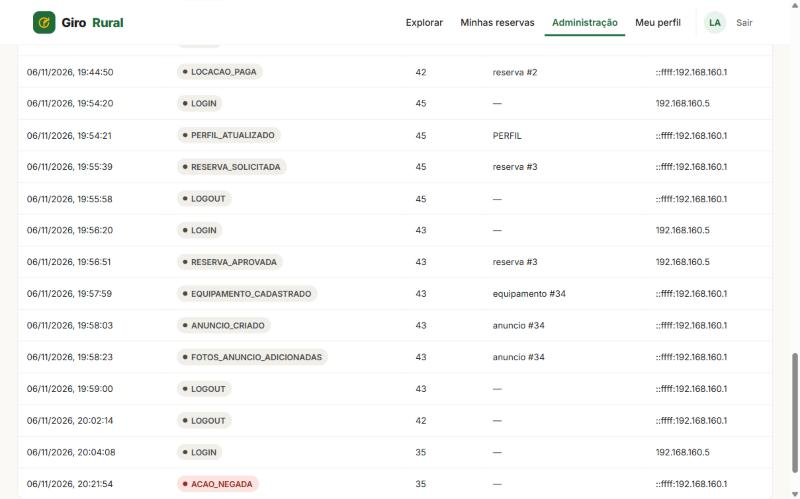

Portainer: os 5 containers da stack `girorural-luana-abrantes` saudáveis, com as imagens `girorural-*:sha-cb2ecfd…`:

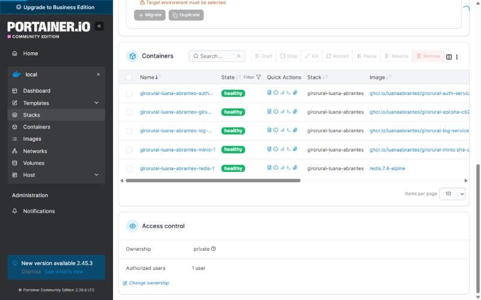
