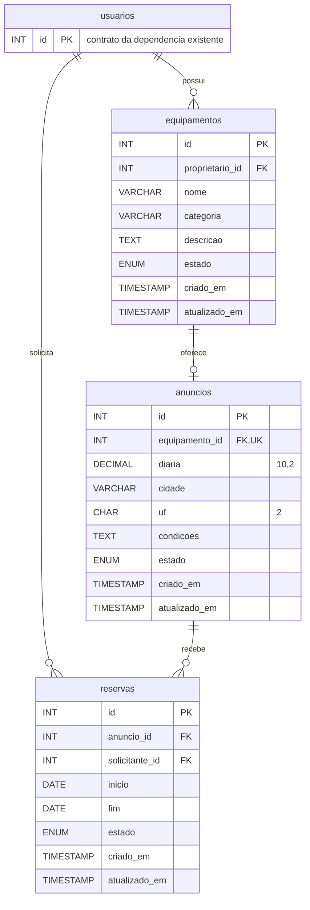

# Issue #1 — modelo de dados e isolamento entre contas

Entrega da etapa 2 limitada à [Issue #1](https://github.com/Luanaabrantes/girorural/issues/1).
Uma conta individual corresponde a `usuarios.id`. Não há organizações ou propriedades
multiusuário. Identidade, papel (`usuario`/`admin`), propriedade comercial e assinatura
são conceitos independentes. Nenhum benefício Free/Pro foi implementado nesta entrega.

## Modelo entidade-relacionamento



A migração [migracao-girorural-issue1.sql](../database/migracao-girorural-issue1.sql)
é aditiva e não modifica as tabelas do catálogo. As novas tabelas usam InnoDB e
utf8mb4. Todas as FKs usam `RESTRICT`, tanto para exclusão como para atualização,
evitando apagar histórico por cascata. Desativação/arquivamento deve substituir
exclusões de recursos referenciados nas entregas futuras.

### Contrato de usuarios e limitação do DDL original

O repositório contém FKs antigas com `usuario_id INT`, mas não o `CREATE TABLE`
original completo de `usuarios`. Portanto, não foi reconstruído um esquema real
suposto. A dependência exigida pela migração é explicitamente `usuarios.id INT`
**assinado**, chave primária de uma única coluna, em InnoDB. O preflight em
`src/rural/migracoes.js` consulta `information_schema` e recusa ausência, tipo,
signedness, PK composta ou engine incompatível **antes** de executar o DDL.
O banco externo não foi consultado e sua compatibilidade não está certificada.

A fixture de integração cria apenas esse contrato mínimo, exclusivamente no banco
descartável. Ela não representa o DDL original nem deve ser aplicada ao banco da
aplicação. Para um desenvolvimento local já existente, conferir `SHOW CREATE TABLE
usuarios` e resolver divergências de contrato em revisão própria; nunca converter
a tabela real automaticamente.

### Restrições e índices

- Equipamento exige dono, nome e categoria não vazios. `descricao` é opcional.
  O índice `(proprietario_id, estado)` atende consultas do proprietário.
- Anúncio não duplica `proprietario_id`: o dono vem do equipamento. A unicidade de
  `equipamento_id` limita o MVP a uma oferta por bem físico, inclusive arquivada.
  Uma futura republicação reutiliza o anúncio; múltiplas ofertas concorrentes
  exigirão decisão e migração próprias. A FK e a chave única dão suporte ao join.
- Diária usa `DECIMAL(10,2)` positivo. O acesso a dados mantém a representação
  decimal textual padrão do mysql2; não converte dinheiro em `Number`/`FLOAT`.
  Cidade não pode ser vazia e UF deve ser uma das 27 siglas brasileiras em maiúsculas.
- Reserva exige anúncio, solicitante e datas. O período é de diárias **inclusivas**:
  `inicio = fim` representa um dia. A restrição verifica `inicio >= 1000-01-01`
  e `fim >= inicio`; não aceita datas zero. Usar modo SQL estrito no desenvolvimento.
  Não há horário/fuso na coluna `DATE`; regras de retirada e virada da diária
  deverão ser definidas antes da Issue #5.
- Os índices de reserva por solicitante e por `(anuncio_id, inicio, fim, estado)`
  suportam a vinculação e consultas futuras. Eles **não impedem sobreposição**.
- Datas de criação/atualização são geridas pelo banco. Não há transferência de
  proprietário, exclusão de recursos ou criação de reservas na API desta entrega.

### Estados

| Entidade | Estado | Significado reservado para o domínio |
| --- | --- | --- |
| Equipamento | `ativo` | Cadastro válido para uma oferta futura; padrão inicial |
| Equipamento | `inativo` | Indisponível para publicação pública |
| Anúncio | `rascunho` | Ainda não publicável; padrão inicial |
| Anúncio | `ativo` | Publicável somente se o equipamento também estiver ativo |
| Anúncio | `inativo` | Oferta temporariamente retirada |
| Anúncio | `arquivado` | Oferta encerrada, mantendo vínculos históricos |
| Reserva | `solicitada` | Pedido pendente; padrão inicial |
| Reserva | `confirmada` | Futura aprovação pelo proprietário |
| Reserva | `recusada` | Futuro pedido recusado |
| Reserva | `cancelada` | Futuro cancelamento autorizado |
| Reserva | `concluida` | Futura conclusão da locação |

Os ENUMs e CHECKs definem o vocabulário, **não um motor de transições**. A Issue #5
implementará autorização por ação, prevenção transacional de sobreposição com
concorrência real, idempotência, regras de cancelamento e snapshots das condições
acordadas. Atualmente alterações diretas por SQL podem criar períodos sobrepostos;
isso não deve ser apresentado como reserva operacional pronta.

## Política de acesso e integração

`src/rural/acesso.js` exporta `criarAcessoRural(db)` com pool/conexão mysql2 injetável.
Não monta rotas, não executa consultas no carregamento e não modifica `src/server.js`.
As rotas HTTP usadas nos testes são somente um harness local.

| Operação interna | Política |
| --- | --- |
| `consultarEquipamentoPrivado(usuario, id)` | Somente proprietário da sessão |
| `consultarAnuncioPrivado(usuario, id)` | Somente proprietário do equipamento vinculado |
| `alterarDescricaoEquipamento(usuario, id, body)` | Somente dono; aceita exclusivamente `descricao` |
| `alterarCondicoesAnuncio(usuario, id, body)` | Somente dono; aceita exclusivamente `condicoes` |
| `consultarReservaPrivada(usuario, id)` | Solicitante ou dono do equipamento; sinaliza as duas relações separadamente |
| `consultarAnuncioPublico(id)` | Projeção explicitamente pública, apenas anúncio e equipamento ativos |

As duas escritas estreitas verificam a propriedade com `SELECT ... FOR UPDATE`
e atualizam no mesmo contexto transacional, repetindo o predicado do proprietário
no UPDATE. Não formam um CRUD: não criam recursos, não ativam anúncios, não
transferem dono e não alteram reservas. São pontos reutilizáveis para a Issue #2.

O argumento `usuario` deve vir **exclusivamente de `req.usuario`**, preenchido pelo
middleware de sessão existente após validação no auth-service. Nunca preencher
esse argumento com `req.body`, query ou parâmetros da URL. A camada de domínio
não valida JWT por conta própria e não substitui a fronteira HTTP de autenticação.
Um `proprietario_id` no corpo é rejeitado como campo não permitido e jamais prova
propriedade. O papel `admin` não cria exceção em nenhuma consulta ou escrita.

Todos os IDs são positivos e seguros, e os valores SQL são parametrizados. Acesso
privado a recurso inexistente e a recurso alheio resulta na mesma mensagem e
status `404`. Falta de identidade válida gera `401`; entrada malformada gera `400`.
Uma futura rota deve mapear `ErroAcessoRural.status` e não expor erros internos do
banco. Não há endpoints novos expostos nesta entrega.

### Dados públicos e privados

A projeção pública contém somente ID do anúncio, nome, categoria, descrição,
diária, cidade, UF e condições. Descrição e condições são conteúdo **publicável**;
não devem receber notas privadas. Equipamentos inativos e anúncios em rascunho,
inativos ou arquivados não são públicos. IDs de usuários, referência interna do
equipamento, datas internas e reservas não integram a resposta pública.

O cadastro privado completo é acessível somente ao dono. A consulta de uma reserva
é restrita às duas partes e inclui seus IDs e flags de relação, sem e-mail, telefone,
JWT, assinatura ou demais dados da tabela de usuários. Não há listagem de reservas
de terceiros. A assinatura Free/Pro não participa da autorização de propriedade.

## Migração e reversão no desenvolvimento

O executor `scripts/migrar-rural.js` **não carrega `.env` e não usa `DB_*`** da
aplicação. Só aceita host loopback, banco `girorural_dev_*` ou `girorural_test_*`
e recusa `NODE_ENV=production`. Usar um banco local isolado com a dependência
`usuarios` previamente validada. Não apontar túnel local para banco externo.

Exemplo PowerShell, após instalar as dependências com os lockfiles existentes:

```powershell
npm ci
npm ci --prefix auth-service
npm ci --prefix log-service
$env:GIRO_DEV_DB_HOST = '127.0.0.1'
$env:GIRO_DEV_DB_PORT = '3306'
$env:GIRO_DEV_DB_NAME = 'girorural_dev_local'
$env:GIRO_DEV_DB_USER = 'usuario_local'
# Fornecer GIRO_DEV_DB_PASSWORD de forma privada, quando necessário.
node scripts/migrar-rural.js            # prévia: valida somente a dependência
node scripts/migrar-rural.js --aplicar  # DDL aditivo nas três tabelas novas
```

O SQL usa `CREATE TABLE IF NOT EXISTS`. Reexecutar não substitui tabelas ou
conserta divergências de estrutura existentes. Inspecionar DDL/índices antes de
reutilizar um banco local. MariaDB faz commit implícito em DDL: uma falha pode
deixar aplicação parcial, exigindo inspeção, nunca remoção automática de dados.

Para reverter, **parar todos os escritores locais e manter acesso exclusivo**:

```powershell
node scripts/migrar-rural.js --reverter --manutencao-exclusiva
```

`reverterVazio` verifica a ausência de dados em **todas** as tabelas do domínio e de
dependentes externos antes do primeiro DROP. Recusa se qualquer uma contiver
registros. Remove somente tabelas vazias, na ordem reservas → anúncios →
equipamentos, sem desativar FKs e preservando `usuarios` e o catálogo.
Se existirem dados, manter o esquema e preparar migração compensatória específica
com backup/restauração verificados. Não apagar dados para forçar a reversão.
O bloqueio de manutenção é um pré-requisito operacional: o script não consegue
impedir um outro cliente SQL de escrever enquanto o DDL é executado.

## Testes e resultados desta execução

```powershell
npm test
npm run docs:validate
node scripts/validar-rural-mariadb.js
```

| Verificação | Resultado em 23/10/2026 |
| --- | --- |
| Sintaxe dos seis arquivos JavaScript novos | Aprovada com `node --check` |
| Testes novos HTTP/domínio e guardas de migração | 13 aprovados, zero falhas |
| Suíte completa, incluindo as atividades anteriores | 97 aprovados, zero falhas |
| OpenAPI catálogo/auth | Válido; nenhuma rota pública nova |
| Integração real MariaDB / aplicação / reversão | **Não executada**: acesso ao Docker engine negado antes da criação do laboratório |

Os testes HTTP usam o middleware real do catálogo e respostas controladas do
auth-service e da persistência. Validam A/B, anônimo, spoof de dono, admin sem
exceção, projeção pública, escrita alheia negada e papéis distintos de reserva.
Não comprovam SQL, locks ou integridade referencial reais. A instalação das
dependências na raiz encontrou uma restrição local EPERM; a suíte foi executada
com as mesmas versões do lockfile instaladas em diretório de apoio e `NODE_PATH`,
sem alterar os manifests versionados.

### Laboratório MariaDB reproduzível

`scripts/validar-rural-mariadb.js` cria um container MariaDB 11.4 com nome exclusivo,
sem portas publicadas, sem `.env` e sem volumes da aplicação. Um container Node 20
compartilha somente o namespace de rede desse banco, isolado com `--network none`,
e monta o checkout **somente para leitura**. A conexão mysql2 é real. As imagens
são baixadas antes do isolamento. O container do banco é parado ao final e seus
dados descartados. Requer Docker engine acessível e as dependências instaladas.

O arquivo `test/rural-mariadb.integration.js`, fora do glob de `npm test`, valida:
aplicação e reexecução da migração; FKs; unicidade; nulidade; CHECKs; `DECIMAL`;
exclusões restritas; consultas/escritas por proprietário; tentativa de spoof;
projeção pública; participantes de reserva; recusa da reversão com dados;
reversão vazia, reaplicação e preservação dos usuários. O script de laboratório
recusa iniciar os testes diretamente sem a marca de ambiente descartável.

**A aplicação e a reversão em MariaDB permanecem pendentes de execução real antes
de aprovar a migração.** Não há evidência positiva inventada. Nenhuma migração foi
executada no banco externo e não houve deploy, alteração no Stripe ou no Portainer.

## Próximas entregas

Issue #2: cadastro e interface; #3: fotos; #4: busca; #5: motor de reservas e
conflitos; #6: painel/histórico operacional; #7: assinatura e limites.
Esta branch implementa somente a fundação da Issue #1 e aguarda revisão por PR,
sem merge automático.
